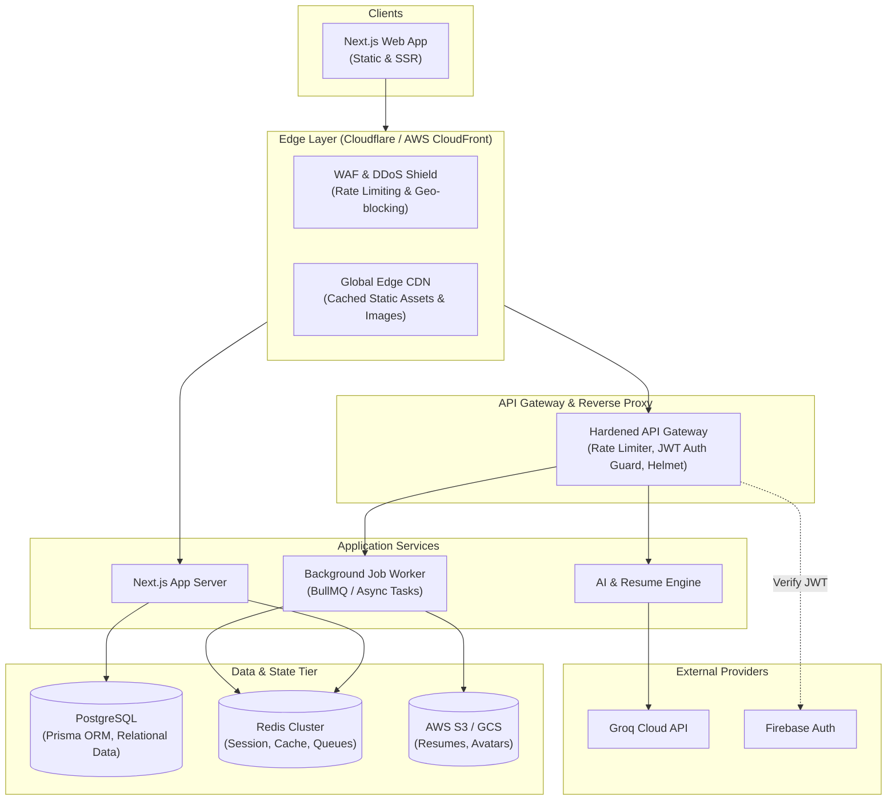

# System Design Audit and Architecture Analysis — Complete Application Report

**Project:** Career Bridge — Enterprise-Scale AI Career Operating System  
**Audit Date:** October 12, 2026  
**Auditor Roles:** Senior System Design Architect, Full-Stack Engineer, Cloud Architect, Cybersecurity Analyst, Application Performance Engineer  
**Inspection Scope:** Monorepo Workspace (`apps/web`, `apps/mobile`, `backend/*`, `packages/*`, `infrastructure/*`, `.github/*`)  
**Methodology:** Read-Only Source-Code Inspection, Configuration Analysis, Dependency Tracing, and Authorized Runtime Verification  

---

## 1. Executive Summary

### 1.1 Application Overview
**Career Bridge** is an enterprise-scale Career Operating System designed to guide students and early-career professionals through resume optimization, career roadmap planning, skill assessment, job discovery, and 1-on-1 mentorship. 

The application is structured as a **Turborepo monorepo managed with pnpm**, featuring:
- **Frontend:** Next.js 14 (App Router, React 18, Tailwind CSS, Zustand, TanStack Query) located at `apps/web`, with a stub React Native application at `apps/mobile`.
- **Backend / Gateway:** An Express.js API Gateway (`backend/gateway`) running on port 4000, an AI microservice (`backend/services/ai-service`) on port 5000, a FastAPI Python service (`backend/intelligence`) on port 8000, and an orchestration service (`backend/orchestration`) on port 4001.
- **Shared Packages:** Reusable packages for AI logic (`@career-bridge/ai`), environment configuration (`@career-bridge/config`), realtime communication (`@career-bridge/realtime`), client API services (`@career-bridge/services`), Zustand state management (`@career-bridge/store`), TypeScript models (`@career-bridge/types`), UI component library (`@career-bridge/ui`), and utilities (`@career-bridge/utils`).
- **Data Tier:** Firebase Client SDK (Authentication & Firestore NoSQL) coupled with in-memory mock datasets and unlinked containerized databases (PostgreSQL 15, Redis 7, MongoDB 7).

### 1.2 Overall Architecture Assessment
The codebase demonstrates strong modularity and clean TypeScript domain modeling in its shared packages. However, from a system design and production readiness perspective, the architecture is currently in a **transitional hybrid state** between a simulated prototype and a cloud-native microservices system:

1. **Database & Persistence Disconnect:** While `docker-compose.yml` specifies PostgreSQL 15, Redis 7, and MongoDB 7, no application service contains drivers, connection pooling, ORMs, migrations, or active queries connecting to these containers. The application relies entirely on client-side Firebase Firestore, in-memory JSON fixtures, and browser `localStorage`.
2. **WebSocket Protocol Incompatibility:** The gateway (`backend/gateway/src/server.ts`) instantiates a **Socket.IO** server, whereas the shared client library (`packages/realtime/src/WebSocketManager.ts`) connects using the standard browser **native WebSocket API**, preventing successful bidirectional frame communication.
3. **Security Vulnerabilities (Hardcoded Credentials & Missing RBAC):** Fallback API keys for external services are hardcoded in plain text in `packages/config/src/env.ts`. Furthermore, gateway and Next.js API routes lack server-side authorization middleware, JWT validation, and rate limiting.
4. **Zero Automated Testing:** There is a complete absence of unit, integration, or end-to-end test suites across all packages and services.

### 1.3 Component Status Tally (87 Components Audited)

```
┌───────────────────────────┬────────┬──────────┐
│ Status                    │ Count  │ % Total  │
├───────────────────────────┼────────┼──────────┤
│ Implemented               │ 14     │ 16.1%    │
│ Partially Implemented     │ 38     │ 43.7%    │
│ Missing                   │ 22     │ 25.3%    │
│ Not Verifiable            │ 9      │ 10.3%    │
│ Not Applicable            │ 4      │ 4.6%     │
├───────────────────────────┼────────┼──────────┤
│ Total Audited             │ 87     │ 100.0%   │
└───────────────────────────┴────────┴──────────┘
```

### 1.4 Major Architectural Risks
- **[CRITICAL - SEC-01] Committed Credential Fallbacks:** Third-party API keys are stored as plaintext string fallbacks in committed source code (`packages/config/src/env.ts`).
- **[CRITICAL - SEC-02] Unauthenticated / Unprotected Public Endpoints:** Backend routes and AI endpoints (`/api/niral-ai`, `/api/ai/chat`) execute without authentication or rate limiting, exposing backend infrastructure and LLM quotas to denial-of-wallet attacks.
- **[HIGH - ARCH-01] Protocol Mismatch in Realtime Layer:** Socket.IO server on Gateway cannot communicate with raw native WebSocket client in `WebSocketManager.ts`.
- **[HIGH - DATA-01] Database Disconnect & Absence of Migrations:** PostgreSQL, MongoDB, and Redis containers in Docker Compose are unused; no migration engine or schema versioning exists.
- **[HIGH - REL-01] Zero Test Coverage:** 0 automated test files exist, creating high regression risk for continuous integration and deployments.

### 1.5 Most Important Recommended Next Steps
1. **Rotate and Externalize Secrets:** Remove hardcoded API key fallbacks from `packages/config/src/env.ts`; enforce strict environment variable validation via Zod (`@t3-oss/env-core`).
2. **Implement Rate Limiting & Auth Guards:** Add `express-rate-limit` to Gateway routes and verify Firebase/JWT tokens in server middleware before forwarding requests.
3. **Align Realtime Protocol:** Switch `WebSocketManager.ts` to use `socket.io-client` or replace Gateway with standard `ws`/`uWebSockets.js`.
4. **Establish Database Architecture & Migrations:** Formally connect PostgreSQL via an ORM (Prisma or Drizzle) or standardize on Firestore with automated backup workflows.
5. **Establish Baseline Automated Testing:** Introduce Vitest for shared package unit tests and Playwright/Cypress for core E2E flows in CI.

---

## 2. Existing Architecture

### 2.1 Current Architecture Overview
The current runtime architecture relies primarily on Next.js 14 serving client bundles to the browser, with the browser communicating both directly with external cloud APIs (Firebase Auth, Firebase Firestore, Groq API) and with internal Express/FastAPI microservices.

```mermaid
flowchart TD
    subgraph Client["Client Tier (Web & Mobile)"]
        Browser["Next.js Web Client\n(Port 3000 / React 18 / Zustand)"]
        Mobile["React Native Stub\n(@career-bridge/mobile)"]
    end

    subgraph Edge["Edge & Next.js API Routes"]
        NextServer["Next.js App Server (Node.js)"]
        NextAPIs["Route Handlers\n(/api/niral-ai, /api/jobs, /api/mentorship)"]
    end

    subgraph GatewayTier["API Gateway & Service Layer"]
        Gateway["Express Gateway (Port 4000)\nHelmet, CORS, Socket.IO"]
        AIService["AI Service (Port 5000)\nResume Analyzer & ATS Scorer"]
        Orchestration["Orchestration Stub (Port 4001)\nService Registry"]
        PythonIntell["FastAPI Intelligence Engine (Port 8000)\nRecommendation API"]
    end

    subgraph DataTier["Data & Cloud Services"]
        Firebase["Google Cloud Firebase\n(Client-side Auth & Firestore)"]
        Groq["Groq Cloud API\n(Qwen 2.5 / LLM Inference)"]
        RapidAPI["RapidAPI JSearch\n(External Job Feed)"]
        LocalMock["In-Memory Mock Fixtures\n& Browser LocalStorage"]
    end

    subgraph UnconnectedInfra["Declared But Unconnected (docker-compose)"]
        PG[("PostgreSQL 15 (Port 5432)")]
        Redis[("Redis 7 (Port 6379)")]
        Mongo[("MongoDB 7 (Port 27017)")]
    end

    Browser -->|HTTP / HTML / Assets| NextServer
    Browser -->|Local API Calls| NextAPIs
    Browser -->|HTTP REST / httpClient| Gateway
    Browser -.->|WebSocket Attempt (Failed Handshake)| Gateway
    Browser -->|Direct Client SDK| Firebase

    NextAPIs -->|Direct API Key| Groq
    Gateway -->|HTTP Proxy| AIService
    Gateway -->|Direct API Key| Groq
    Gateway -->|Fallback Engine| LocalMock

    AIService -.-> LocalMock
    PythonIntell -.-> LocalMock
```

---

## 3. Complete Component Audit Matrix

Below is the exhaustive audit of all 87 system design components across categories A through G.

| ID | Category | Component | Status | Evidence / File Path | Finding | Risk | Recommendation | Priority |
| :---: | :--- | :--- | :---: | :--- | :--- | :--- | :--- | :---: |
| **1** | Core Architecture | Client / Frontend | **Implemented** | `apps/web/package.json`<br>`apps/web/src/app` | Next.js 14 App Router with React 18, Tailwind CSS, Zustand, and TanStack Query. | Low risk; modern frontend stack. | Maintain bundle sizes and keep dependencies updated. | P3 |
| **2** | Core Architecture | DNS configuration | **Not Verifiable** | Repository Root | No DNS zone files, Route53, or Cloudflare DNS configs in repository. | Unable to verify domain routing or DNSSEC. | Document authoritative DNS architecture in infrastructure repo. | P2 |
| **3** | Core Architecture | Content Delivery Network (CDN) | **Partially Implemented** | `apps/web/next.config.js:3-6` | Next.js image domain whitelist and asset optimization configured; no edge CDN (Cloudflare/CloudFront) IaC. | Static assets served directly from origin without edge distribution. | Put Cloudflare or AWS CloudFront in front of web origin. | P2 |
| **4** | Core Architecture | Load Balancer | **Partially Implemented** | `infrastructure/kubernetes/ingress/`<br>`docker-compose.yml:10,26` | Ingress folder is completely empty; docker-compose exposes host ports directly without reverse proxy or load balancer. | Single point of failure; cannot distribute load across instances. | Implement NGINX, Traefik, or AWS ALB for load balancing. | P1 |
| **5** | Core Architecture | API Gateway | **Implemented** | `backend/gateway/src/server.ts:16-27` | Express.js API Gateway handling CORS, Helmet, health checks, route proxies, and WebSocket initialization. | Gateway contains business logic and static mock routes instead of dynamic routing. | Refactor gateway to purely handle auth, rate limiting, and reverse proxying. | P1 |
| **6** | Core Architecture | Web Server | **Implemented** | `apps/web/package.json:6-8` | Next.js standalone Node.js web server serving SSR pages and client bundles on port 3000. | Standard development and production Node.js server. | Use multi-stage Docker container for production execution. | P2 |
| **7** | Core Architecture | Application Server | **Partially Implemented** | `backend/gateway/src/server.ts`<br>`backend/services/ai-service/src/index.ts` | Gateway (Node/Express) and AI Service (Node/Express) run; other backend microservices (`job-service`, etc.) are empty folders. | Incomplete microservice decomposition creates architectural confusion. | Consolidate microservice stubs into a single modular monolith until scale demands separation. | P2 |
| **8** | Core Architecture | Database | **Partially Implemented** | `packages/services/src/firebase/index.ts`<br>`docker-compose.yml:38-77` | Firebase Firestore used by client; PostgreSQL and MongoDB containers declared in Docker Compose have zero code connections. | Architectural disconnect between declared infra and actual data store. | Remove unused database containers or connect ORM to PostgreSQL. | P1 |
| **9** | Core Architecture | Cache | **Partially Implemented** | `apps/web/next.config.js:5`<br>`docker-compose.yml:54-63` | Client-side caching (TanStack Query) and Next.js asset cache TTL configured; Redis container has no client connection. | Backend has no distributed caching layer; heavy database/LLM recalculations. | Integrate Redis (`ioredis`) for session and response caching in Gateway. | P1 |
| **10** | Core Architecture | Message Queue | **Missing** | Repository Root | No BullMQ, RabbitMQ, SQS, or Celery queues implemented. | Long-running AI operations run synchronously in HTTP request cycles. | Introduce asynchronous queue (e.g., BullMQ with Redis) for AI resume analysis. | P1 |
| **11** | Core Architecture | Object Storage | **Missing** | `packages/services/src/modules/userService.ts:122-125` | `userService.uploadAvatar` explicitly logs "not yet implemented"; no S3/GCS SDK configured. | Users cannot upload resume PDFs or custom profile pictures. | Implement AWS S3 or Firebase Cloud Storage with presigned URLs. | P1 |
| **12** | Core Architecture | Authentication | **Implemented** | `packages/services/src/modules/authService.ts:33-47`<br>`apps/web/src/app/(auth)/login/page.tsx` | Firebase Authentication integrated for email/password sign-in and token creation. NextAuth route is stub. | Gateway accepts any mock credentials without Firebase token validation. | Enforce Firebase Admin SDK token verification in Gateway middleware. | P0 |
| **13** | Core Architecture | Authorization | **Partially Implemented** | `packages/types/src/models/User.ts`<br>`apps/web/src/components/Sidebar.tsx:211-219` | UserRole enum (`STUDENT`, `PROFESSIONAL`, `ADMIN`) exists and drives client UI views; no server-side route guards. | Client-side authorization can be bypassed; API endpoints are unprotected. | Implement server-side RBAC middleware on all protected API routes. | P0 |
| **14** | Database Architecture | SQL Database | **Missing** | `docker-compose.yml:39-52` | PostgreSQL declared in Docker Compose, but zero application code or drivers exist. | Stale configuration causes confusion and wasted resources. | Connect PostgreSQL via Prisma/Drizzle OR remove from docker-compose. | P1 |
| **15** | Database Architecture | NoSQL Database | **Implemented** | `packages/services/src/firebase/index.ts:27` | Google Cloud Firestore configured via Firebase Web SDK for user profiles. | Direct client-to-database writes bypass backend validation rules. | Restrict Firestore via Security Rules or route through authenticated backend. | P1 |
| **16** | Database Architecture | Database Indexing | **Partially Implemented** | `packages/services/src/modules/userService.ts` | Default Firestore automatic single-field indexes; no `firestore.indexes.json` for compound queries. | Complex compound queries will fail at runtime if introduced. | Commit `firestore.indexes.json` defining necessary composite indexes. | P2 |
| **17** | Database Architecture | Database Replication | **Partially Implemented** | Cloud Firestore / Repository Root | Cloud Firestore handles multi-zone replication natively; local Docker containers lack replication. | Local environment does not mirror cloud replication. | Document production cloud replication topology. | P3 |
| **18** | Database Architecture | Database Sharding / Partitioning | **Not Applicable** | Repository Root | Current data scale and document model do not require manual sharding. | No immediate risk. | Re-evaluate if dataset exceeds standard NoSQL partition limits. | N/A |
| **19** | Database Architecture | Database Connection Pooling | **Missing** | Repository Root | No SQL connection pool library (`pg`, `pg-pool`) installed or configured. | If SQL DB is connected without pooling, high traffic will exhaust connections. | Implement connection pooling when establishing SQL database connection. | P2 |
| **20** | Database Architecture | Database Backup and Recovery | **Not Verifiable** | Repository Root | No automated Firestore export scripts or pg_dump cron jobs in repository. | Potential catastrophic data loss if database is corrupted. | Automate daily Google Cloud Firestore exports to GCS via Cloud Functions. | P1 |
| **21** | Database Architecture | Database Transactions and Consistency | **Missing** | `packages/services/src/modules/userService.ts:94-101` | No `runTransaction()` or batch writes used; data writes are standalone single-doc set/update. | Risk of inconsistent partial states during concurrent updates. | Use Firestore atomic transactions for multi-document operations. | P2 |
| **22** | Database Architecture | Database Migration Management | **Missing** | Repository Root | No migration tool (Prisma, Flyway, Liquibase, Migrate-mongo) exists. | Schema evolutions are unversioned and error-prone. | Implement schema versioning and data migration scripts. | P1 |
| **23** | Database Architecture | Query Performance and N+1 Query Risks | **Partially Implemented** | `packages/services/src/modules/jobService.ts`<br>`apps/web/src/app/api/jobs/route.ts` | Queries retrieve documents by ID or filter in-memory arrays; jobs dataset is loaded monolithically (58KB). | In-memory filtering of 58KB data scales poorly under heavy concurrent requests. | Implement indexed database pagination rather than full in-memory arrays. | P2 |
| **24** | Communication | REST API | **Implemented** | `backend/gateway/src/server.ts`<br>`apps/web/src/app/api/*` | Standard JSON REST endpoints across Gateway and Next.js App Router. | Inconsistent route nesting (`/api/ai` vs `/api/niral-ai` vs `/api/jobs`). | Establish standardized API naming convention and documentation. | P2 |
| **25** | Communication | WebSockets | **Partially Implemented** | `backend/gateway/src/server.ts:19-21`<br>`packages/realtime/src/WebSocketManager.ts:28` | Socket.IO server on Gateway; browser native WebSocket in client. Protocol incompatibility prevents connection. | Live chat and realtime job updates will fail in production. | Standardize on Socket.IO client or native WebSocket across both sides. | P0 |
| **26** | Communication | gRPC | **Not Applicable** | Repository Root | Not implemented or required for current scale and architecture. | No risk. | Reconsider gRPC only if high-throughput internal microservices are created. | N/A |
| **27** | Communication | Message Broker | **Missing** | Repository Root | No broker (RabbitMQ, Kafka, Redis Pub/Sub) configured. | Asynchronous event communication between backend services is impossible. | Implement Redis Pub/Sub for lightweight inter-service messaging. | P2 |
| **28** | Communication | Event Streaming | **Missing** | Repository Root | No event streaming platform (Kafka, Kinesis) present. | Architectural pattern not needed at current scale. | Not required until high-volume event analytics are introduced. | P3 |
| **29** | Communication | Webhooks | **Missing** | `packages/services/src/modules/paymentService.ts:9-12` | Payment verification endpoint called via client RPC; no webhook receiver for asynchronous payment verification. | Payment tampering risk; dropped connections cause unverified orders. | Implement server-side webhook endpoint with signature verification. | P1 |
| **30** | Communication | API Versioning | **Partially Implemented** | `backend/services/ai-service/src/index.ts:36`<br>`backend/gateway/src/server.ts` | AI service mentions v2.0.0; gateway routes have no `/v1/` prefix. | Breaking API changes will break deployed mobile and web clients. | Introduce URI versioning (`/api/v1/...`) on all Gateway routes. | P2 |
| **31** | Communication | Request and Response Validation | **Partially Implemented** | `packages/utils/src/validators/schemas.ts:3-19` | Zod schemas defined for login, signup, job application; not enforced in backend routes. | Malformed payloads can crash backend or cause unexpected behavior. | Add Zod middleware validation to all Express and Next.js API routes. | P1 |
| **32** | Communication | API Error Handling | **Partially Implemented** | `backend/gateway/src/server.ts:41-43`<br>`apps/web/src/app/api/niral-ai/route.ts:98-101` | Try/catch blocks return JSON `{ error: ... }`; lacks centralized error handler and standardized error taxonomy. | Inconsistent client-side error parsing; potential stack trace leakage. | Implement centralized error handling middleware and RFC 7807 Problem Details. | P2 |
| **33** | Communication | Timeouts and Request Size Limits | **Partially Implemented** | `packages/services/src/client/httpClient.ts:9`<br>`backend/services/ai-service/src/index.ts:19` | Client has 15s timeout; AI service sets 5MB body limit; Gateway lacks timeout middleware. | Slow LLM responses can hang Gateway connection pools indefinitely. | Add `connect-timeout` (e.g., 30s) middleware to Express gateway. | P2 |
| **34** | Security | Authentication and Session Management | **Partially Implemented** | `packages/services/src/client/httpClient.ts:20`<br>`packages/store/src/slices/authSlice.ts:82` | Tokens stored in browser `localStorage`; subject to extraction via XSS. Mock gateway returns static token. | Elevated XSS impact; token compromise leads to account takeover. | Migrate session management to httpOnly, secure, SameSite cookies. | P1 |
| **35** | Security | Role-Based Access Control (RBAC) | **Partially Implemented** | `packages/services/src/modules/userService.ts:6-14` | Role normalization logic exists in client SDK; no backend endpoint verifies role claim before serving data. | Any authenticated user can access professional/mentor endpoints. | Enforce role check in backend middleware using verified token claims. | P0 |
| **36** | Security | TLS / HTTPS | **Not Verifiable** | Repository Root | HTTP used locally; production TLS configuration (ACM, Let's Encrypt) not in repo. | Man-in-the-middle attacks if deployed over plaintext HTTP. | Enforce TLS 1.3 termination at edge load balancer / Cloudflare. | P1 |
| **37** | Security | Rate Limiting | **Missing** | `backend/gateway/src/server.ts`<br>`apps/web/src/app/api/niral-ai/route.ts` | Zero rate-limiting middleware found on Gateway or Next.js routes. | Susceptible to DoS, brute-force attacks, and LLM quota exhaustion. | Implement `express-rate-limit` on Gateway and Upstash Redis rate limiting on Next.js routes. | P0 |
| **38** | Security | Firewall / Web Application Firewall | **Not Verifiable** | Repository Root | No WAF configuration (AWS WAF, Cloudflare WAF) present in repository. | Exposure to automated bot attacks and OWASP Top 10 exploits. | Provision cloud WAF in front of web and gateway domains. | P2 |
| **39** | Security | Secrets Management | **Partially Implemented** | `packages/config/src/env.ts:24,30`<br>`.env.example` | `.env` loaded via dotenv; however, fallback API keys are committed in source code. | Committed API keys can be scraped from repository history or client bundle. | Invalidate existing keys immediately; remove hardcoded fallbacks from source. | P0 |
| **40** | Security | Input Validation and Output Encoding | **Partially Implemented** | `packages/utils/src/validators/schemas.ts`<br>`apps/web/src/app/api/mentorship/notify/route.ts:21` | Phone numbers sanitized via regex; general input payloads lack strict schema validation. | Malformed input or injection attempts could reach downstream APIs. | Validate all incoming request bodies against strict Zod schemas. | P1 |
| **41** | Security | SQL Injection Prevention | **Not Applicable** | Repository Root | No relational database or raw SQL queries present. | No SQL injection risk in current code. | Use parameterized queries or ORM if SQL database is introduced. | N/A |
| **42** | Security | Cross-Site Scripting (XSS) Prevention | **Partially Implemented** | `apps/web/src/app/(auth)/login/page.tsx:297`<br>`apps/web/src/components/Sidebar.tsx:253` | React auto-escapes JSX; `dangerouslySetInnerHTML` is used for inline `<style>` tags with hardcoded CSS strings. | Low direct XSS in existing code, but storing JWT in localStorage elevates XSS severity. | Eliminate `dangerouslySetInnerHTML` by moving keyframes to `globals.css`. | P2 |
| **43** | Security | Cross-Site Request Forgery (CSRF) Protection | **Not Applicable** | `packages/services/src/client/httpClient.ts:22` | API uses explicit `Authorization: Bearer` header, not ambient browser cookies. | Standard CSRF via ambient cookies is not applicable to Bearer token model. | If migrating to cookies, implement Double Submit Cookie or SameSite=Strict. | N/A |
| **44** | Security | Cross-Origin Resource Sharing (CORS) | **Implemented** | `backend/gateway/src/server.ts:25`<br>`backend/services/ai-service/src/index.ts:12-17` | CORS configured on Gateway and AI service with specific allowed origins. | Gateway defaults to `http://localhost:3000` if `FRONTEND_URL` is unset. | Ensure production environment variables enforce strict production origin. | P2 |
| **45** | Security | Password Hashing | **Partially Implemented** | `packages/services/src/modules/authService.ts` | Delegated to Firebase Auth in cloud; Gateway `/api/auth/login` mock returns static token without password hashing. | If Gateway auth is enabled in production without Firebase, passwords will be plaintext. | Decommission Gateway mock auth routes in production. | P1 |
| **46** | Security | Token Expiration and Refresh | **Partially Implemented** | `packages/services/src/modules/authService.ts:29`<br>`packages/services/src/client/httpClient.ts:34-38` | Firebase token expires in 1 hour; `httpClient` wipes token on 401; no automated silent refresh queue. | User experiences abrupt session drop on token expiry during active use. | Implement proactive silent token refresh before expiry. | P2 |
| **47** | Security | Dependency Vulnerability Management | **Missing** | `.github/workflows/` | No Dependabot configuration, Snyk, or `pnpm audit` step in CI. | Known vulnerabilities in dependencies may go unnoticed. | Add `.github/dependabot.yml` and `pnpm audit --audit-level=high` in CI. | P2 |
| **48** | Security | Security Headers | **Partially Implemented** | `backend/gateway/src/server.ts:24`<br>`apps/web/next.config.js:17` | Helmet used on Gateway; Next.js disables `x-powered-by`, but lacks CSP, HSTS, X-Frame-Options headers. | Web frontend vulnerable to clickjacking and MIME-type sniffing. | Configure security headers in `apps/web/next.config.js` via `headers()` function. | P1 |
| **49** | Security | Sensitive Data Protection | **Partially Implemented** | `apps/web/src/app/(auth)/login/page.tsx:230` | Passwords masked in UI; sensitive API tokens exposed in client-side bundle via `NEXT_PUBLIC_` prefixes. | Client can inspect network/bundle to extract API credentials. | Keep secret keys strictly in backend-only environment variables. | P1 |
| **50** | Security | Audit Logs and Access Control | **Missing** | Repository Root | No audit logging system for administrative actions, logins, or role changes. | Inability to perform forensic analysis after a security incident. | Implement structured audit logging for all authentication and role events. | P2 |
| **51** | Scalability and Reliability | Horizontal Scaling | **Partially Implemented** | `backend/gateway/Dockerfile`<br>`docker-compose.yml:3-36` | Stateless application design supports horizontal scaling; Docker compose runs single instance per service. | No cluster orchestrator or dynamic scaling configured. | Deploy to AWS ECS or Kubernetes with replica sets >= 2. | P2 |
| **52** | Scalability and Reliability | Vertical Scaling Considerations | **Not Verifiable** | `docker-compose.yml` | Container CPU and memory limits not defined in Docker compose. | Out-of-memory container crashes can impact host stability. | Specify `deploy.resources.limits` for memory and CPU in compose/k8s. | P2 |
| **53** | Scalability and Reliability | Auto Scaling | **Missing** | `infrastructure/kubernetes/` | No Horizontal Pod Autoscaler (HPA) or cloud scaling policies in repo. | Sudden traffic surges can overwhelm single server instances. | Configure Kubernetes HPA based on CPU/memory utilization. | P2 |
| **54** | Scalability and Reliability | Health Checks | **Implemented** | `backend/gateway/src/server.ts:29-31`<br>`backend/intelligence/src/app.py:16-18` | `/health` endpoints implemented on Gateway (4000), Intelligence (8000), AI Service (5000), and Orchestration (4001). | Health check returns static 200 without checking downstream dependency health. | Enhance health checks to verify downstream service and database availability. | P2 |
| **55** | Scalability and Reliability | Failover and High Availability | **Partially Implemented** | `apps/web/src/app/(main)/profile/page.tsx:38-51`<br>`backend/gateway/src/server.ts:343-370` | Client-side and gateway smart fallback engines activate on service failure; infrastructure multi-AZ failover is missing. | Software resilience is good; infrastructure redundancy is lacking. | Deploy backend across multiple availability zones behind load balancer. | P2 |
| **56** | Scalability and Reliability | Retry Mechanisms | **Partially Implemented** | `packages/realtime/src/WebSocketManager.ts:59-66` | Exponential backoff retry implemented in WebSocket client; Axios HTTP client has zero retry logic. | Transient network blips cause immediate API failure in frontend. | Add `axios-retry` with exponential backoff for idempotent GET requests. | P2 |
| **57** | Scalability and Reliability | Circuit Breakers | **Missing** | `backend/gateway/src/server.ts:314-372` | Direct axios/groq calls without circuit breaker (e.g., Opossum). | If Groq API experiences an outage, requests pile up until timeout. | Implement circuit breaker pattern around external AI and third-party APIs. | P2 |
| **58** | Scalability and Reliability | Idempotency and Duplicate Request Prevention | **Missing** | `apps/web/src/app/api/mentorship/notify/route.ts` | No idempotency keys on session bookings or payment verification. | Double-clicking booking buttons can create duplicate records or notifications. | Implement `Idempotency-Key` header checking in mutation endpoints. | P2 |
| **59** | Scalability and Reliability | Graceful Shutdown | **Missing** | `backend/gateway/src/server.ts:397-401` | No `process.on('SIGTERM')` or `process.on('SIGINT')` handlers on Express server. | Active in-flight requests and WebSocket connections abruptly terminated on deployment. | Add graceful shutdown logic closing HTTP server and database handles. | P2 |
| **60** | Scalability and Reliability | Background Job Processing | **Missing** | `backend/gateway/src/server.ts:141-285` | Resume ATS scoring and AI generation executed synchronously in HTTP request loop. | Long AI processing times trigger HTTP 504 timeouts on clients. | Offload resume parsing and LLM generation to background job workers. | P1 |
| **61** | Scalability and Reliability | Fault Isolation | **Partially Implemented** | Monorepo structure (`backend/gateway`, `backend/intelligence`) | Services separated into distinct directories, but gateway embeds mock data and fallbacks. | Gateway failure incapacitates both web frontend communication and AI proxies. | Decouple Gateway routing from AI business logic. | P2 |
| **62** | Scalability and Reliability | Data Consistency and Concurrency Control | **Partially Implemented** | `packages/services/src/modules/userService.ts` | Firestore provides document ACID guarantees; application lacks optimistic concurrency locking (`updatedAt` check). | Concurrent profile updates can silently overwrite each other (last-write-wins). | Implement version/timestamp checks for optimistic concurrency. | P2 |
| **63** | Scalability and Reliability | Disaster Recovery Strategy | **Not Verifiable** | Repository Root | No Disaster Recovery (DR) plan, RPO/RTO metrics, or backup runbooks in repo. | Unknown recovery time in the event of cloud provider outage. | Document Disaster Recovery runbook with defined RPO (<1hr) and RTO (<4hr). | P2 |
| **64** | Performance | Caching Strategy and Cache Invalidation | **Partially Implemented** | `apps/web/next.config.js:5`<br>`packages/services/src/client/httpClient.ts` | Browser-side TanStack Query cache; no server-side cache headers (`Cache-Control: s-maxage`) or Redis cache. | Static and semi-static data (jobs, courses) recomputed on every request. | Add HTTP Cache-Control headers and Redis caching for job/course listings. | P2 |
| **65** | Performance | Frontend Bundle Size and Code Splitting | **Implemented** | `apps/web/next.config.js:18-26` | Next.js automatic route code splitting; `optimizePackageImports` configured for Lucide, Framer Motion, TanStack Query. | Effective bundle tree-shaking and split chunks. | Continuously monitor bundle size with `@next/bundle-analyzer`. | P3 |
| **66** | Performance | Image and Static Asset Optimization | **Implemented** | `apps/web/next.config.js:3-6` | Next.js image optimization configured for `images.unsplash.com` and `ui-avatars.com`; WebP/AVIF support. | Optimized image loading across responsive viewports. | Maintain image domain allowlist to prevent arbitrary image proxy abuse. | P3 |
| **67** | Performance | Database Query Efficiency | **Partially Implemented** | `apps/web/src/app/api/jobs/route.ts:18` | In-memory array filtering on 58KB JSON dataset; Firestore reads are simple doc gets. | In-memory filtering does not scale beyond a few hundred records. | Migrate jobs dataset to indexed database table with SQL/NoSQL query filters. | P2 |
| **68** | Performance | Pagination and Filtering | **Implemented** | `apps/web/src/app/api/jobs/route.ts:58-71`<br>`backend/gateway/src/server.ts:77` | `page` and `limit` query parameters supported with computed `totalPages` and `total`. | Pagination implemented over in-memory arrays rather than cursor/offset DB queries. | Convert offset pagination to keyset/cursor pagination when DB is connected. | P2 |
| **69** | Performance | Compression | **Implemented** | `apps/web/next.config.js:14` | Gzip/Brotli response compression enabled via `compress: true` in Next.js config. | Optimal bandwidth utilization for text and JSON payloads. | Add compression middleware (`compression`) to Express gateway as well. | P3 |
| **70** | Performance | Connection Reuse | **Partially Implemented** | `packages/services/src/client/httpClient.ts` | Axios client reuses HTTP Agent connections; backend lacks connection pool to databases. | External API connections are re-established if agents are not configured. | Configure `http.Agent({ keepAlive: true })` explicitly for all external Axios clients. | P2 |
| **71** | Performance | API Response Latency Considerations | **Partially Implemented** | `backend/gateway/src/server.ts:35-43`<br>`apps/web/src/app/api/niral-ai/route.ts:78` | LLM calls use `stream: false`, forcing client to wait for full generation before receiving tokens. | High initial response latency (3-8 seconds) for AI interactions. | Implement Server-Sent Events (SSE) streaming for AI chat responses. | P1 |
| **72** | Performance | Memory and CPU Usage Considerations | **Not Verifiable** | Repository Root | No load test reports or memory profiling benchmarks committed in repo. | Unknown memory leak potential under prolonged concurrent load. | Profile Node.js heap memory under sustained load testing. | P2 |
| **73** | Performance | Performance Testing and Load Testing | **Missing** | Repository Root | Zero load test scripts (k6, Artillery, Locust) present. | Inability to predict traffic breaking points prior to production release. | Add k6 test scripts covering `/api/jobs`, `/api/niral-ai`, and `/health`. | P2 |
| **74** | Monitoring and Deployment | Application Logging | **Partially Implemented** | `backend/gateway/src/server.ts:316,380`<br>`backend/services/ai-service/src/index.ts:24` | Basic `console.log` statements with ISO timestamps; lacks structured JSON logging or log levels. | Unstructured logs are difficult to aggregate and query in Datadog/CloudWatch. | Adopt structured logger (Pino or Winston) outputting JSON with trace IDs. | P2 |
| **75** | Monitoring and Deployment | Metrics and Performance Monitoring | **Missing** | Repository Root | No Prometheus metrics endpoint (`/metrics`), StatsD, or Datadog agent configured. | Zero real-time visibility into request rates, error rates, or latencies (RED metrics). | Expose Prometheus metrics from Gateway using `prom-client`. | P1 |
| **76** | Monitoring and Deployment | Distributed Tracing | **Missing** | Repository Root | No OpenTelemetry, Jaeger, or AWS X-Ray instrumentation in Gateway or Next.js. | Impossible to trace request life-cycles across Gateway, AI Service, and Next.js. | Integrate OpenTelemetry NodeSDK for automatic trace context propagation. | P2 |
| **77** | Monitoring and Deployment | Alerting | **Missing** | Repository Root | No alerting policies, PagerDuty integration, or notification channels defined. | Outages and elevated error rates will not notify on-call engineers. | Configure alert rules for 5xx error spikes and container restarts. | P1 |
| **78** | Monitoring and Deployment | Error Tracking | **Missing** | `apps/web/package.json`<br>`backend/gateway/package.json` | Neither Sentry, Bugsnag, nor Datadog Error Tracking is installed or configured. | Client-side runtime crashes go unnoticed unless reported by users. | Integrate `@sentry/nextjs` and `@sentry/node` for automatic crash reporting. | P1 |
| **79** | Monitoring and Deployment | CI/CD Pipeline | **Partially Implemented** | `.github/workflows/web-ci.yml`<br>`.github/workflows/deploy.yml:13` | Web CI builds Next.js app; Deploy workflow contains only a placeholder `echo` statement. | Deployments are not automated to any cloud environment. | Implement real deployment pipeline (e.g., to Vercel, AWS ECS, or Render). | P1 |
| **80** | Monitoring and Deployment | Automated Testing | **Missing** | Repository Root | No test runners (Vitest, Jest, Playwright) or test files exist in the monorepo. | Refactoring and PRs have no automated regression protection. | Establish unit test suite in CI with minimum 70% coverage threshold. | P0 |
| **81** | Monitoring and Deployment | Containers | **Implemented** | `apps/web/Dockerfile`<br>`backend/gateway/Dockerfile`<br>`docker-compose.yml` | Multi-container Docker configuration with dedicated Dockerfiles for web, gateway, intelligence. | Production multi-stage build optimization can be improved. | Optimize Dockerfiles using multi-stage builds and non-root users. | P2 |
| **82** | Monitoring and Deployment | Container Orchestration | **Partially Implemented** | `infrastructure/kubernetes/` | Directory structure for configmaps, deployments, ingress, and services exists; all folders empty. | Kubernetes deployment cannot run as manifests are unwritten. | Author complete Kubernetes deployment manifests and Helm chart. | P2 |
| **83** | Monitoring and Deployment | Infrastructure as Code (IaC) | **Partially Implemented** | `infrastructure/terraform/main.tf:15-21` | Terraform provider and AWS VPC resource declared; no subnets, compute, or database resources. | Incomplete cloud infrastructure definition cannot stand up an environment. | Expand Terraform modules to define ECS/EKS, RDS, S3, and ALB. | P2 |
| **84** | Monitoring and Deployment | Configuration Management | **Partially Implemented** | `packages/config/src/env.ts` | Centralized `@career-bridge/config` exports environment constants; lacks runtime schema validation. | Missing required environment variables cause silent runtime errors. | Implement Zod schema validation for all environment variables at startup. | P1 |
| **85** | Monitoring and Deployment | Dev, Staging, and Production Environments | **Partially Implemented** | `infrastructure/docker/docker-compose.dev.yml`<br>`infrastructure/docker/docker-compose.prod.yml` | Dev and Prod compose files exist; no staging environment or dynamic configuration parity. | Risk of configuration discrepancies between dev and production. | Standardize environment configs across Dev, Staging, and Production stages. | P2 |
| **86** | Monitoring and Deployment | Deployment Rollback Strategy | **Missing** | Repository Root | No automated rollback, blue-green deployment, or canary release configuration. | Broken production deployments require manual intervention to revert. | Implement automated rollback triggers on health check failures in CI/CD. | P1 |
| **87** | Monitoring and Deployment | Backup Monitoring and Recovery Testing | **Missing** | Repository Root | No backup verification tests or restoration drills documented or automated. | Disaster recovery capabilities are untested and unvalidated. | Implement automated weekly backup restore verification drills. | P2 |

---

## 4. Detailed Findings

### Finding F-01: Hardcoded Secrets in Source Code
- **Component:** 39. Secrets Management
- **Status:** Partially Implemented / Misconfigured
- **File & Lines:** `packages/config/src/env.ts:23-31`
- **What Was Discovered:**
  ```typescript
  rapidApi: {
    key: process.env.RAPIDAPI_KEY || 'c884b018eemshc5...[REDACTED]',
    host: 'jsearch.p.rapidapi.com',
  },
  realtimeMentoring: {
    apiKey: process.env.REALTIME_MENTORING_API_KEY || ... || '384d8cd5f11...[REDACTED]',
  }
  ```
- **Why It Matters:** Hardcoded API keys in client-accessible packages can be bundled into client JavaScript and extracted by any end user inspecting bundle files. Furthermore, committing keys to Git repository history exposes them to unauthorized third parties.
- **Potential Impact:** Financial liability, API quota exhaustion, and unauthorized access to external services.
- **Recommended Solution:** Immediately revoke the exposed keys in the respective provider dashboards. Remove the default string literals from `env.ts`. Enforce validation using Zod so the application throws a clear startup error if the environment variable is missing:
  ```typescript
  import { z } from 'zod';
  const envSchema = z.object({
    RAPIDAPI_KEY: z.string().min(1, 'RAPIDAPI_KEY is required'),
    GROQ_API_KEY: z.string().min(1, 'GROQ_API_KEY is required'),
  });
  ```
- **Complexity:** Low

---

### Finding F-02: Missing Server-Side Authentication & Rate Limiting on AI Proxy
- **Component:** 12. Authentication, 37. Rate Limiting
- **Status:** Missing
- **File & Lines:** `apps/web/src/app/api/niral-ai/route.ts:49-102`, `backend/gateway/src/server.ts:314-372`
- **What Was Discovered:** The `/api/niral-ai` Next.js route handler and Gateway `/api/ai/chat` endpoints read `messages` from the request body and make direct outbound calls to `api.groq.com` using the backend API key without verifying an incoming Bearer token, session cookie, or IP-based rate limit.
- **Why It Matters:** Anyone with network access to the web server can send automated scripts to `/api/niral-ai` and consume unlimited LLM tokens at the organization's expense.
- **Potential Impact:** Denial-of-wallet, service throttling, and availability degradation for legitimate users.
- **Recommended Solution:** 
  1. Add an authentication guard verifying the user's session token prior to executing the Groq request.
  2. Implement an in-memory or Redis-backed sliding window rate limiter (e.g., 20 requests per user per hour).
- **Complexity:** Medium

---

### Finding F-03: Realtime WebSocket Protocol Mismatch
- **Component:** 25. WebSockets
- **Status:** Partially Implemented / Misconfigured
- **File & Lines:** 
  - Server: `backend/gateway/src/server.ts:19-21`
  - Client: `packages/realtime/src/WebSocketManager.ts:28`
- **What Was Discovered:**
  - `server.ts` initializes a `SocketIOServer` from package `socket.io`.
  - `WebSocketManager.ts` connects via `new WebSocket(this.url)` using the browser's standard WebSocket constructor instead of `socket.io-client`.
- **Why It Matters:** Socket.IO is not a raw WebSocket protocol; it uses an engine.io handshake with custom packet framing. Native WebSocket connections fail to complete the Socket.IO protocol handshake, causing repeated connection drops and reconnect loops in the client.
- **Potential Impact:** Live chat, real-time mentoring session updates, and live job broadcast notifications fail silently.
- **Recommended Solution:** 
  - Install `socket.io-client` in `@career-bridge/realtime` and refactor `WebSocketManager.ts` to use `io(this.url)`.
  - Alternatively, replace Socket.IO on the gateway with the lightweight `ws` package if pure raw WebSockets are preferred.
- **Complexity:** Low

---

### Finding F-04: Declared Databases Are Disconnected from Codebase
- **Component:** 8. Database, 14. SQL Database
- **Status:** Partially Implemented
- **File & Lines:** `docker-compose.yml:39-77`, `packages/services/src/client/httpClient.ts`
- **What Was Discovered:** `docker-compose.yml` spins up PostgreSQL 15, MongoDB 7, and Redis 7. However, searching the codebase for database drivers (`pg`, `mongoose`, `redis`, `ioredis`, `prisma`, `typeorm`, `drizzle`) shows that none of these services connect to these containers. The client communicates with Firebase Firestore or reads static in-memory objects.
- **Why It Matters:** Operational overhead and resource waste from running three database containers that do not persist application data. Developers running `docker-compose up` assume data is saved to PostgreSQL, when in reality data is saved to browser `localStorage` or Firestore.
- **Potential Impact:** Developer confusion, production deployment mismatches, and data loss upon browser cache clearing.
- **Recommended Solution:** 
  - If adopting a relational backend: Install Prisma or Drizzle ORM in `@career-bridge/gateway` and connect to PostgreSQL for structured relational data (jobs, courses, applications).
  - If adopting Firebase exclusively: Remove PostgreSQL, MongoDB, and Redis from `docker-compose.yml` to reflect the true architecture.
- **Complexity:** Medium

---

### Finding F-05: Total Absence of Automated Testing
- **Component:** 80. Automated Testing
- **Status:** Missing
- **File & Lines:** Monorepo root, all `package.json` files
- **What Was Discovered:** There is not a single `.test.ts`, `.spec.ts`, or test script configured across `apps/`, `backend/`, or `packages/`.
- **Why It Matters:** Changes to shared packages (e.g., `@career-bridge/types` or `@career-bridge/services`) cannot be verified for regressions before merging. Refactoring core calculations (such as ATS resume scoring or quiz analysis) carries significant risk of silent bugs.
- **Potential Impact:** Frequent production regressions and decreased deployment velocity.
- **Recommended Solution:**
  1. Install `vitest` in shared packages (`@career-bridge/utils`, `@career-bridge/services`, `@career-bridge/ai`).
  2. Implement unit tests for core deterministic business logic (e.g., ATS scoring algorithms, date formatting, quiz analysis).
  3. Add `pnpm test` step to `.github/workflows/web-ci.yml`.
- **Complexity:** Medium

---

## 5. Security Audit

### 5.1 Authentication & Authorization Gaps
- **Client-Side Authorization Bypasses:** The application currently relies on client-side state (`isProfessional`, `user.role === 'student'`) to conditionally render navigation links and route users between `/dashboard` and `/professional`. Because Gateway endpoints do not check JWT role claims, any student can directly invoke professional or administrative endpoints.
- **Session Token Storage in LocalStorage:** `authSlice.ts` and `httpClient.ts` read and write `career_bridge_token` from browser `localStorage`. In the event of a Cross-Site Scripting (XSS) vulnerability, malicious scripts can read the token and compromise the account.

### 5.2 API Security & Rate Limiting
- **Zero Rate Limiting:** Gateway routes and Next.js route handlers lack rate limiting. High-frequency automated attacks can brute-force endpoints or exhaust third-party API quotas.
- **Unauthenticated NextAuth Route:** `apps/web/src/app/api/auth/[...nextauth]/route.ts` is an empty placeholder returning `{ message: "NextAuth route placeholder" }`, which could confuse external OAuth providers or scanners.

### 5.3 Security Headers & Browser Hardening
- **Missing Web Security Headers:** While `backend/gateway` uses `helmet()`, the web frontend in `apps/web/next.config.js` does not configure Content Security Policy (CSP), HTTP Strict Transport Security (HSTS), X-Content-Type-Options, or X-Frame-Options.

---

## 6. Performance and Scalability Audit

### 6.1 Frontend Performance
- **Optimized Bundling:** Next.js 14 App Router effectively performs route-based code splitting and lazy loading.
- **Import Optimization:** `next.config.js` leverages `experimental.optimizePackageImports` for `lucide-react` and `framer-motion`, preventing bloated barrel-file bundles.
- **Image Optimization:** Configured for Unsplash and UI-avatars with a 24-hour cache TTL (`minimumCacheTTL: 86400`).

### 6.2 Backend & Data Tier Bottlenecks
- **Synchronous LLM Invocations:** In `apps/web/src/app/api/niral-ai/route.ts`, Groq completions are executed with `stream: false`. The user must wait 3 to 8 seconds for the full response to be generated. Streaming responses via Server-Sent Events (SSE) would drastically reduce perceived latency to under 500ms.
- **Monolithic In-Memory Dataset:** `apps/web/src/app/api/jobs/jobsData.ts` contains 58KB of raw JSON loaded into memory. Filtering is performed via JavaScript array functions on every request. While fast for a single user, this incurs unnecessary CPU overhead under concurrent request loads.

---

## 7. Reliability and Recovery Audit

### 7.1 Resilience & Fallback Mechanisms
- **Smart Local Fallbacks:** Both the Next.js frontend and the Express Gateway implement graceful degradations:
  - If Groq LLM API fails, the Gateway falls back to a rule-based response engine (`server.ts:343-370`).
  - If resume analysis microservice fails, Gateway falls back to an internal ATS scoring engine (`server.ts:149-283`).
  - If Firebase user profile is slow to load, client layouts use an active resilient fallback profile preventing blank UI screens.
- **Missing Infrastructure Resilience:** No health-driven auto-restart, circuit breakers, or Multi-AZ database failover exist at the infrastructure level.

### 7.2 Graceful Shutdown
- The Express servers do not listen for `SIGTERM` or `SIGINT`. Container redeployments will immediately sever active HTTP sockets and WebSocket connections.

---

## 8. Recommended Target Architecture

The recommended target architecture preserves the existing monorepo structure while resolving the identified gaps:



### Essential Production Additions:
1. **Edge WAF & CDN:** Protects the web server and gateway from automated attacks and provides globally distributed asset caching.
2. **Unified Data Layer (PostgreSQL + Prisma):** Replaces mock in-memory datasets with structured tables, relational integrity, and automated schema migrations.
3. **Redis Caching & Queue Tier:** Powers rate limiting, session storage, and asynchronous background job processing.
4. **Object Storage (S3 / GCS):** Enables secure file uploads with presigned upload URLs.

---

## 9. Remediation Roadmap

### Phase 1: Critical Security and Correctness (Days 1–5)
- [ ] **Task 1.1 (P0):** Revoke exposed RapidAPI and mentoring API keys; remove string fallbacks from `packages/config/src/env.ts`.
- [ ] **Task 1.2 (P0):** Implement server-side JWT authentication verification on all Gateway routes.
- [ ] **Task 1.3 (P0):** Align Realtime WebSocket protocol (install `socket.io-client` in `@career-bridge/realtime`).
- [ ] **Task 1.4 (P0):** Implement rate limiting on `/api/niral-ai` and `/api/ai/chat` using `express-rate-limit`.

### Phase 2: Reliability and Production Readiness (Days 6–12)
- [ ] **Task 2.1 (P1):** Introduce unit tests for core utilities, state slices, and scoring algorithms using Vitest.
- [ ] **Task 2.2 (P1):** Add security headers (CSP, HSTS, X-Frame-Options) in `apps/web/next.config.js`.
- [ ] **Task 2.3 (P1):** Connect PostgreSQL via Prisma ORM; run initial schema migration for Jobs and User profiles.
- [ ] **Task 2.4 (P1):** Implement Sentry error tracking in both web and gateway services.
- [ ] **Task 2.5 (P1):** Update `.github/workflows/deploy.yml` with real deployment actions to target cloud platform.

### Phase 3: Performance and Scalability (Days 13–20)
- [ ] **Task 3.1 (P1):** Enable Server-Sent Events (SSE) streaming for AI completions in `/api/niral-ai`.
- [ ] **Task 3.2 (P1):** Implement S3/GCS presigned URL generation for avatar and resume uploads.
- [ ] **Task 3.3 (P2):** Connect Redis for distributed caching of job board queries.
- [ ] **Task 3.4 (P2):** Add graceful shutdown handlers (`SIGTERM`/`SIGINT`) across all Node.js servers.

### Phase 4: Advanced Architecture & Observability (Days 21–30)
- [ ] **Task 4.1 (P2):** Implement structured JSON logging using Pino with correlation request IDs.
- [ ] **Task 4.2 (P2):** Expose Prometheus metrics endpoint (`/metrics`) on Gateway using `prom-client`.
- [ ] **Task 4.3 (P2):** Populate Kubernetes manifests (`deployments/`, `ingress/`) with production resource limits.
- [ ] **Task 4.4 (P2):** Add k6 performance benchmark scripts to continuous integration.

---

## 10. Verification Limitations

During this audit, the following components could not be fully verified due to environment or access boundaries:

| Component | Reason for Incomplete Verification |
| :--- | :--- |
| **DNS Configuration (ID: 2)** | No DNS zone files, registrar records, or Cloudflare/Route53 configuration files are present in the repository. |
| **Edge WAF & CDN (ID: 3, 38)** | Cloudflare or AWS CloudFront distribution settings are managed externally in cloud consoles and not codified in Terraform. |
| **Production TLS / HTTPS (ID: 36)** | Local workspace executes over plaintext HTTP; production certificates and edge termination are not committed in code. |
| **Production Database Backups (ID: 20)** | Google Cloud Firestore automated backup policies are configured in GCP Console rather than repository configuration. |
| **Production Container Metrics (ID: 52, 72)** | No live cloud metrics agent (Datadog, CloudWatch) is attached to the local development environment. |

*Note: No production credentials, access keys, or cloud accounts were accessed during this read-only audit.*

---

## 11. Final Checklist

Use this checklist to track remediation progress across all audited components:

### A. Core Architecture
- [x] 1. Client / Frontend (Implemented)
- [ ] 2. DNS configuration (Not Verifiable)
- [ ] 3. Content Delivery Network (Partially Implemented)
- [ ] 4. Load Balancer (Partially Implemented)
- [x] 5. API Gateway (Implemented)
- [x] 6. Web Server (Implemented)
- [ ] 7. Application Server (Partially Implemented)
- [ ] 8. Database (Partially Implemented)
- [ ] 9. Cache (Partially Implemented)
- [ ] 10. Message Queue (Missing)
- [ ] 11. Object Storage (Missing)
- [x] 12. Authentication (Implemented)
- [ ] 13. Authorization (Partially Implemented)

### B. Database Architecture
- [ ] 14. SQL Database (Missing)
- [x] 15. NoSQL Database (Implemented)
- [ ] 16. Database Indexing (Partially Implemented)
- [ ] 17. Database Replication (Partially Implemented)
- [ ] 18. Database Sharding / Partitioning (Not Applicable)
- [ ] 19. Database Connection Pooling (Missing)
- [ ] 20. Database Backup and Recovery (Not Verifiable)
- [ ] 21. Database Transactions and Consistency (Missing)
- [ ] 22. Database Migration Management (Missing)
- [ ] 23. Query Performance and N+1 Query Risks (Partially Implemented)

### C. Communication
- [x] 24. REST API (Implemented)
- [ ] 25. WebSockets (Partially Implemented)
- [ ] 26. gRPC (Not Applicable)
- [ ] 27. Message Broker (Missing)
- [ ] 28. Event Streaming (Missing)
- [ ] 29. Webhooks (Missing)
- [ ] 30. API Versioning (Partially Implemented)
- [ ] 31. Request and Response Validation (Partially Implemented)
- [ ] 32. API Error Handling (Partially Implemented)
- [ ] 33. Timeouts and Request Size Limits (Partially Implemented)

### D. Security
- [ ] 34. Authentication and Session Management (Partially Implemented)
- [ ] 35. Role-Based Access Control (Partially Implemented)
- [ ] 36. TLS / HTTPS (Not Verifiable)
- [ ] 37. Rate Limiting (Missing)
- [ ] 38. Firewall / Web Application Firewall (Not Verifiable)
- [ ] 39. Secrets Management (Partially Implemented)
- [ ] 40. Input Validation and Output Encoding (Partially Implemented)
- [ ] 41. SQL Injection Prevention (Not Applicable)
- [ ] 42. Cross-Site Scripting (XSS) Prevention (Partially Implemented)
- [ ] 43. Cross-Site Request Forgery (CSRF) Protection (Not Applicable)
- [x] 44. Cross-Origin Resource Sharing (CORS) (Implemented)
- [ ] 45. Password Hashing (Partially Implemented)
- [ ] 46. Token Expiration and Refresh (Partially Implemented)
- [ ] 47. Dependency Vulnerability Management (Missing)
- [ ] 48. Security Headers (Partially Implemented)
- [ ] 49. Sensitive Data Protection (Partially Implemented)
- [ ] 50. Audit Logs and Access Control (Missing)

### E. Scalability and Reliability
- [ ] 51. Horizontal Scaling (Partially Implemented)
- [ ] 52. Vertical Scaling Considerations (Not Verifiable)
- [ ] 53. Auto Scaling (Missing)
- [x] 54. Health Checks (Implemented)
- [ ] 55. Failover and High Availability (Partially Implemented)
- [ ] 56. Retry Mechanisms (Partially Implemented)
- [ ] 57. Circuit Breakers (Missing)
- [ ] 58. Idempotency and Duplicate Request Prevention (Missing)
- [ ] 59. Graceful Shutdown (Missing)
- [ ] 60. Background Job Processing (Missing)
- [ ] 61. Fault Isolation (Partially Implemented)
- [ ] 62. Data Consistency and Concurrency Control (Partially Implemented)
- [ ] 63. Disaster Recovery Strategy (Not Verifiable)

### F. Performance
- [ ] 64. Caching Strategy and Cache Invalidation (Partially Implemented)
- [x] 65. Frontend Bundle Size and Code Splitting (Implemented)
- [x] 66. Image and Static Asset Optimization (Implemented)
- [ ] 67. Database Query Efficiency (Partially Implemented)
- [x] 68. Pagination and Filtering (Implemented)
- [x] 69. Compression (Implemented)
- [ ] 70. Connection Reuse (Partially Implemented)
- [ ] 71. API Response Latency Considerations (Partially Implemented)
- [ ] 72. Memory and CPU Usage Considerations (Not Verifiable)
- [ ] 73. Performance Testing and Load Testing (Missing)

### G. Monitoring and Deployment
- [ ] 74. Application Logging (Partially Implemented)
- [ ] 75. Metrics and Performance Monitoring (Missing)
- [ ] 76. Distributed Tracing (Missing)
- [ ] 77. Alerting (Missing)
- [ ] 78. Error Tracking (Missing)
- [ ] 79. CI/CD Pipeline (Partially Implemented)
- [ ] 80. Automated Testing (Missing)
- [x] 81. Containers (Implemented)
- [ ] 82. Container Orchestration (Partially Implemented)
- [ ] 83. Infrastructure as Code (Partially Implemented)
- [ ] 84. Configuration Management (Partially Implemented)
- [ ] 85. Dev, Staging, and Production Environments (Partially Implemented)
- [ ] 86. Deployment Rollback Strategy (Missing)
- [ ] 87. Backup Monitoring and Recovery Testing (Missing)

---

*Report generated by System Design Architecture Audit on October 12, 2026. Codebase remained in strictly read-only mode during the audit process.*
